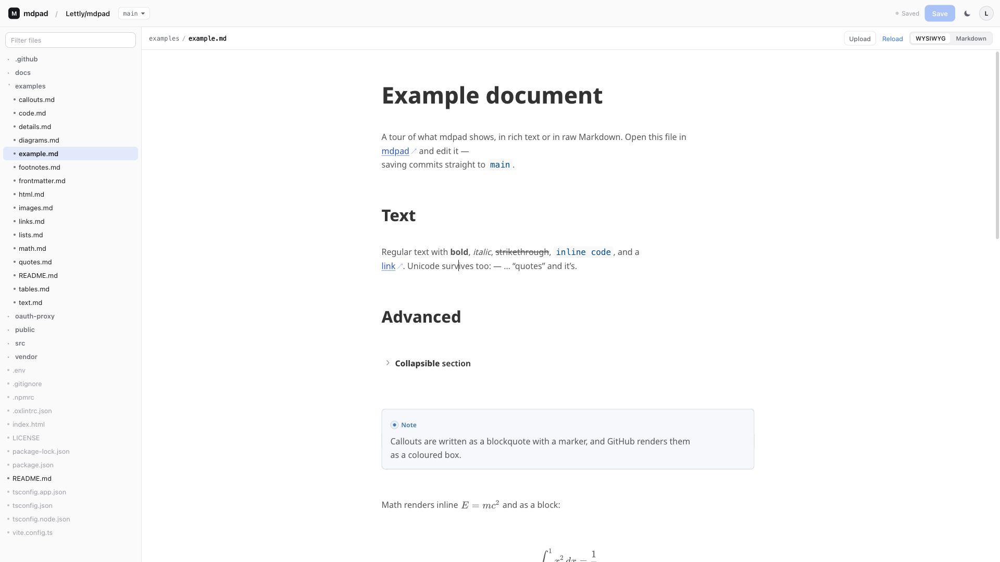

<p align="center">
  
</p>

<h1 align="center">mdpad</h1>

<p align="center">
  A WYSIWYG Markdown editor for GitHub repositories.<br>
  Browse the tree, edit in rich text or raw Markdown, commit straight to the branch.
</p>

<p align="center">
  <a href="https://lettly.github.io/mdpad/"><strong>Open mdpad →</strong></a>
</p>



Everything runs in the browser: no server, no backend, no database. The page talks directly to
`api.github.com`.

## Try it

[`examples/`](examples/README.md) has one file per category of content — text, lists, tables, code,
math, callouts, collapsible sections, footnotes, raw HTML, quotes, links, images, diagrams and front
matter — plus a short tour in [`example.md`](examples/example.md). Open any of them in the app and
edit it:

<https://lettly.github.io/mdpad/#/Lettly/mdpad/blob/main/examples/README.md>

## Using it

1. Open the app and press **Sign in with GitHub** — the device flow shows a code, you type it at
   <https://github.com/login/device>, and the page picks up the token by polling.
2. Or paste a fine-grained personal access token with **Contents: read and write** on the
   repositories you want to edit. Create one at
   <https://github.com/settings/personal-access-tokens/new>.
3. Paste a repository or file URL:
   - `https://github.com/owner/repo`
   - `https://github.com/owner/repo/blob/main/docs/guide.md`
   - `https://raw.githubusercontent.com/owner/repo/main/README.md`
   - or just `owner/repo`

Deep links work too, so a URL like `#/owner/repo/blob/main/README.md` opens that file directly.

`⌘S` / `Ctrl+S` opens the commit dialog. Saves are plain commits to the selected branch — no pull
request, no review. If the file changed on GitHub in the meantime, GitHub rejects the write and
you get a conflict error; reload and re-apply.

**Upload** — the button above the editor, **File → Upload files…** in the right-click menu, `/` then
*Upload files*, or dropping or pasting files onto the editor — opens the upload dialog. Pick a
destination folder from the list, or type a path that does not exist yet to create it with the
upload, then choose a commit message: the files are committed to the branch in one commit. Images
(png, jpg, gif, svg, webp, avif, bmp, ico) are embedded at the cursor as
``; everything else becomes a link. Both use a path relative to the
document, so the Markdown keeps working wherever the repository is rendered.

## Blocks

There is no toolbar: the surface is Markra's. Select text and the formatting menu appears above it
(bold, italic, strikethrough, code, highlight, clear formatting, quote, lists, block type, link,
copy). Typing `/` at the end of a line opens the block menu, each entry with its icon, which lists
Markra's own commands (headings, lists, task list, quote, callout, table, code block) and the
GitHub-flavoured blocks mdpad adds:

| Entry | Inserts |
| --- | --- |
| Collapsible section | `<details>` + `<summary>` |
| Footnote | a `[^1]` reference and its definition |
| Math block | `$$ … $$` |
| Keyboard key | `<kbd>⌘</kbd>` |
| Divider | `---` |

Right-click anywhere on the surface for the same blocks, formatting for a selection, the clipboard,
and **Open link** when the pointer is on a link. A right-click outside the selection moves the caret
to the pointer; inside it, the selection is kept. Arrow keys and `Enter` pick an entry, and any other
key closes the menu and goes to the editor.

A collapsible section is one block: the summary and the content render as Markdown — nested
sections, callouts, tables, code and raw HTML included — and the section folds as it does on
GitHub. The body is ordinary editor content: click into it and type, with the same live preview as
the rest of the document. Click the title to rename it; the chevron folds the section. There is no
dialog: `Enter` in the title moves into the body, `Esc` cancels the rename, and clicking away keeps
it. The **Open by default** checkbox in the title editor writes the `open` attribute, and the other
attributes on `<details>` are kept. Other raw HTML renders as content; click it to reveal the
source in place.

## Development

```bash
npm install
npm run dev      # http://localhost:5173
npm run build    # type-check + production build into dist/
```

## Deployment

Pushes to `main` build the site and publish it to GitHub Pages through
`.github/workflows/deploy.yml`. The Vite `base` is `/mdpad/`, so the app lives at
`https://<user>.github.io/mdpad/`. Rename the repository and update `base` in `vite.config.ts` if
you want a different path.

Note that a Pages site is public even when its repository is private: anyone with the URL can load
the app. There is nothing secret in it — each visitor brings their own token.

## How it works

| Piece | What it does |
| --- | --- |
| `src/lib/github.ts` | REST client for the contents, trees and branches endpoints |
| `src/lib/githubUrl.ts` | Turns pasted repository/file URLs into `owner`, `repo`, `branch`, `path` |
| `src/lib/oauth.ts` | GitHub device flow client (start, poll, cancel) and the OAuth app/relay override |
| `src/lib/route.ts` | Hash router, so deep links work on a static host |
| `src/lib/tree.ts` | Flat git tree → collapsible file tree |
| `src/components/MarkraEditor.tsx` | Mounts Markra's paper shell and editor surface, wired to mdpad's commit flow |
| `src/markra/` | Markra's app-side editor chrome: paper surface, floating menus, plugin UI, spellcheck menu, and the stylesheet that draws all of it |
| `src/editor/markra/` | mdpad's own editor plugins: collapsible sections, extra block commands, Markdown → HTML for section bodies |
| `vendor/markra/` | Markra's editor packages, vendored as source (see its `NOTICE.md`) |
| `oauth-proxy/` | Cloudflare Worker that adds CORS headers to GitHub's OAuth endpoints |

Saving reads the file's blob `sha` when it is opened and sends it back with the write, which is how
GitHub detects that you edited a stale copy.

Markdown from the repository is sanitised with DOMPurify before it renders, so a hostile file cannot
script a page that holds your token.

## License

mdpad is licensed under the **GNU Affero General Public License v3.0** (`LICENSE`), because its
editor is Markra's, which is AGPL-3.0-only. Running a modified mdpad on a network means offering
its users the complete source.

## Credits

The editor — the live Markdown preview, its paper layout and typography, tables, code blocks,
callouts, math, the slash menu, block drag and the hover controls — is
[Markra](https://github.com/markrahq/markra) by the Markra authors. Its packages are vendored in
`vendor/markra/` and its app-side editor chrome and stylesheet in `src/markra/`, at the commit
recorded in `vendor/markra/NOTICE.md`.

## The OAuth relay

`github.com/login/device/code` and `github.com/login/oauth/access_token` answer without
`Access-Control-Allow-Origin`, so a static page cannot read them. `oauth-proxy/` is a 60-line
Cloudflare Worker that forwards those two POSTs and adds the header. It holds no secret: the device
flow needs only a public client id.

```bash
cd oauth-proxy
npm install
npx wrangler deploy     # https://mdpad-oauth.<account>.workers.dev
```

`ALLOWED_ORIGINS` in `oauth-proxy/wrangler.toml` is the CORS allowlist — only the deployed site and
the local dev server may call it. The app reads the relay URL and client id from `.env`, which is
committed because both values are public.

Redeploy the worker after changing that allowlist; nothing else needs rebuilding.

Anyone can run their own pair: **Advanced — use your own OAuth app** on the login screen takes a
client id and a relay URL, saves them in that browser's local storage under `mdpad.oauth`, and uses
them instead of the built ones. The fields are stored when you press **Save**, and also when a
sign-in starts with a valid pair in them, so typing a pair and going straight to **Sign in with
GitHub** is enough. That is the way to fork mdpad onto your own relay without rebuilding it, and a
fork with no values in `.env` still works — the section opens itself and sign-in appears as soon as
both fields are saved. **Use the built-in app** drops the override.

GitHub throttles the relay now and then, because a Worker shares Cloudflare's egress addresses with
everything else on them: `/device/code` or `/access_token` answers `429` with "Access to this site
has been restricted". The client treats that as temporary — it honours `Retry-After`, backs off up
to 30 s, keeps polling, and says so in the card while it waits. Pasting a personal access token
skips OAuth entirely.

## Limits

- Only `.md`, `.markdown`, `.mdx` and `.txt` files are editable; the rest are listed but dimmed.
- Saving a document goes through the contents API, which caps out at 1 MB per file. Uploads go
  through the Git Data API instead and are capped at 25 MB per file.
- The device flow signs in with a **classic** token scoped `repo`: read/write on every repository
  you can push to. A fine-grained personal access token is the narrower option when that matters.
- A `<details>` block is one block: the wrapper tags are hidden, the body stays Markdown you edit
  directly, and the summary is a row you rename in place. Nested sections render inside it, and a
  section without a `<summary>` shows GitHub's default label. A non-standard layout — trailing text
  after the close tag, for example — falls back to a rendered block with a double-click editor.
  Other raw HTML is rendered as content — a centred header is centred — and clicking it reveals the
  source.
- The rich editor edits the Markdown source directly, so text round-trips as written: bullets stay
  `-`, table separators stay as authored, and footnote definitions are untouched. The flip side is
  that a hard-wrapped paragraph keeps its source line breaks instead of reflowing like GitHub.
- Markdown mode is an escape hatch for the rare file that needs byte-exact text; it is never
  required to edit.
