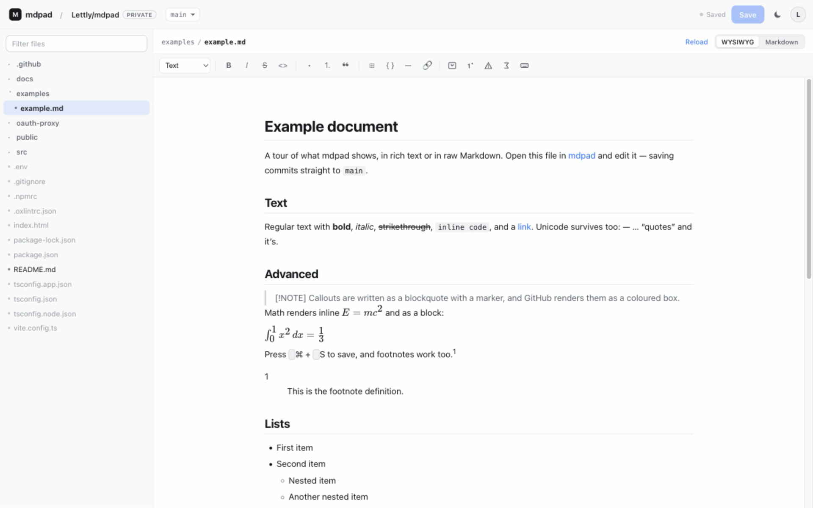

<p align="center">
  
</p>

<h1 align="center">mdpad</h1>

<p align="center">
  A WYSIWYG Markdown editor for GitHub repositories.<br>
  Browse the tree, edit in rich text or raw Markdown, commit straight to the branch.
</p>

<p align="center">
  <a href="https://lettly.github.io/mdpad/"><strong>Open mdpad →</strong></a>
</p>



Everything runs in the browser: no server, no backend, no database. The page talks directly to
`api.github.com`.

## Try it

[`examples/example.md`](examples/example.md) is a tour of what the editor renders — headings,
lists, a table, a code block, a blockquote. Open it in the app and edit it:

<https://lettly.github.io/mdpad/#/Lettly/mdpad/blob/main/examples/example.md>

## Using it

1. Open the app and press **Sign in with GitHub** — the device flow shows a code, you type it at
   <https://github.com/login/device>, and the page picks up the token by polling.
2. Or paste a fine-grained personal access token with **Contents: read and write** on the
   repositories you want to edit. Create one at
   <https://github.com/settings/personal-access-tokens/new>.
3. Paste a repository or file URL:
   - `https://github.com/owner/repo`
   - `https://github.com/owner/repo/blob/main/docs/guide.md`
   - `https://raw.githubusercontent.com/owner/repo/main/README.md`
   - or just `owner/repo`

Deep links work too, so a URL like `#/owner/repo/blob/main/README.md` opens that file directly.

`⌘S` / `Ctrl+S` opens the commit dialog. Saves are plain commits to the selected branch — no pull
request, no review. If the file changed on GitHub in the meantime, GitHub rejects the write and
you get a conflict error; reload and re-apply.

## Advanced blocks

The chips at the end of the toolbar add the GitHub-flavoured blocks that have no plain rich-text
form:

| Chip | Inserts |
| --- | --- |
| Details | `<details>` + `<summary>` |
| Footnote | a `[^1]` reference and its definition |
| Callout | `> [!NOTE]` |
| Math | `$$ … $$` |
| Key | `<kbd>⌘</kbd>` |

They land in the document where the cursor is. A collapsible section is an editable block: type the
summary (Markdown works there too) and write the body as ordinary blocks. Other raw HTML renders as
content; click it to edit the HTML behind it.

## Development

```bash
npm install
npm run dev      # http://localhost:5173
npm run build    # type-check + production build into dist/
```

## Deployment

Pushes to `main` build the site and publish it to GitHub Pages through
`.github/workflows/deploy.yml`. The Vite `base` is `/mdpad/`, so the app lives at
`https://<user>.github.io/mdpad/`. Rename the repository and update `base` in `vite.config.ts` if
you want a different path.

Note that a Pages site is public even when its repository is private: anyone with the URL can load
the app. There is nothing secret in it — each visitor brings their own token.

## How it works

| Piece | What it does |
| --- | --- |
| `src/lib/github.ts` | REST client for the contents, trees and branches endpoints |
| `src/lib/githubUrl.ts` | Turns pasted repository/file URLs into `owner`, `repo`, `branch`, `path` |
| `src/lib/oauth.ts` | GitHub device flow client (start, poll, cancel) |
| `src/lib/route.ts` | Hash router, so deep links work on a static host |
| `src/lib/tree.ts` | Flat git tree → collapsible file tree |
| `src/components/MarkdownEditor.tsx` | Milkdown editor: rich text, with a raw Markdown escape hatch |
| `oauth-proxy/` | Cloudflare Worker that adds CORS headers to GitHub's OAuth endpoints |

Saving reads the file's blob `sha` when it is opened and sends it back with the write, which is how
GitHub detects that you edited a stale copy.

Markdown from the repository is sanitised with DOMPurify before it renders, so a hostile file cannot
script a page that holds your token.

## The OAuth relay

`github.com/login/device/code` and `github.com/login/oauth/access_token` answer without
`Access-Control-Allow-Origin`, so a static page cannot read them. `oauth-proxy/` is a 60-line
Cloudflare Worker that forwards those two POSTs and adds the header. It holds no secret: the device
flow needs only a public client id.

```bash
cd oauth-proxy
npm install
npx wrangler deploy     # https://mdpad-oauth.<account>.workers.dev
```

`ALLOWED_ORIGINS` in `oauth-proxy/wrangler.toml` is the CORS allowlist — only the deployed site and
the local dev server may call it. The app reads the relay URL and client id from `.env`, which is
committed because both values are public.

Redeploy the worker after changing that allowlist; nothing else needs rebuilding.

## Limits

- Only `.md`, `.markdown`, `.mdx` and `.txt` files are editable; the rest are listed but dimmed.
- Writes go through the contents API, which caps out at 1 MB per file.
- The device flow signs in with a **classic** token scoped `repo`: read/write on every repository
  you can push to. A fine-grained personal access token is the narrower option when that matters.
- A `<details>` block is a real node: summary and body are edited in place and written back as
  `<details><summary>…</summary>…</details>`. Other raw HTML is preserved as an atomic node and
  **rendered as content** — a centred header is centred. Click it to edit the HTML behind it.
- Rich text rewrites bullets and table separators (`-` becomes `*`), and footnote definitions are
  re-serialised. Everything else round-trips verbatim.
- Markdown mode is an escape hatch for the rare file that needs byte-exact text; it is never
  required to edit.
