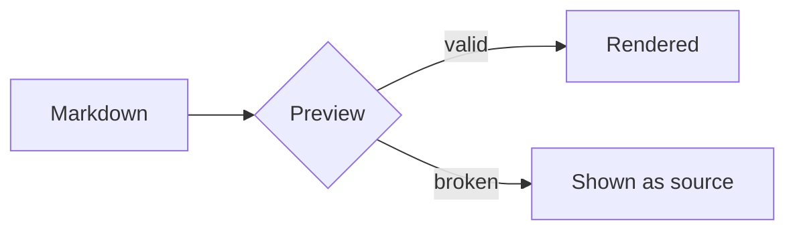

# Code

## Inline

Use `npm install` to install, `npm run dev` to develop, and `npm run build` to ship.
Inline code can contain `**stars**`, `_underscores_`, and `<html>`.

## Fenced blocks

```ts
type Session = {
  repo: string
  branch: string
}

export function describe(session: Session): string {
  return `${session.repo}@${session.branch}`
}
```

```python
def fib(n: int) -> int:
    a, b = 0, 1
    for _ in range(n):
        a, b = b, a + b
    return a
```

```rust
fn main() {
    let items = vec!["one", "two", "three"];
    for item in items {
        println!("{item}");
    }
}
```

```bash
npm install
npm run dev      # http://localhost:5173
npm run build    # type-check + production build
```

```json
{
  "name": "mdpad",
  "private": true,
  "dependencies": {
    "react": "^19.3.1"
  }
}
```

```css
.paper {
  max-width: 860px;
  margin-inline: auto;
  padding-inline: 72px;
}
```

## No language

```
A plain fenced block has no language and no highlighting.
It still keeps its line breaks and its  spacing.
```

## A block with a long line

```ts
const veryLongLine = 'this line is deliberately long so that the block has to decide between wrapping and scrolling sideways in the preview'
```

## Indented code

    An indented block is code too.
    Four spaces at the start of each line.

## Code inside other blocks

> A quote can hold a fence:
>
> ```sh
> echo "inside a quote"
> ```

- A list item can hold one too:

  ```js
  console.log('inside a list')
  ```

## Tilde fences

~~~md
# A heading written in a tilde-fenced block
~~~

## Mermaid


