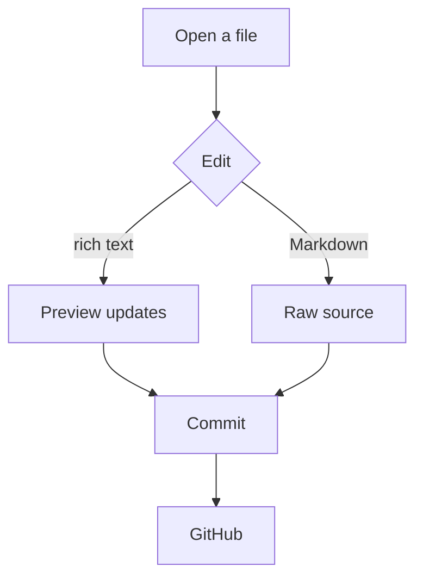
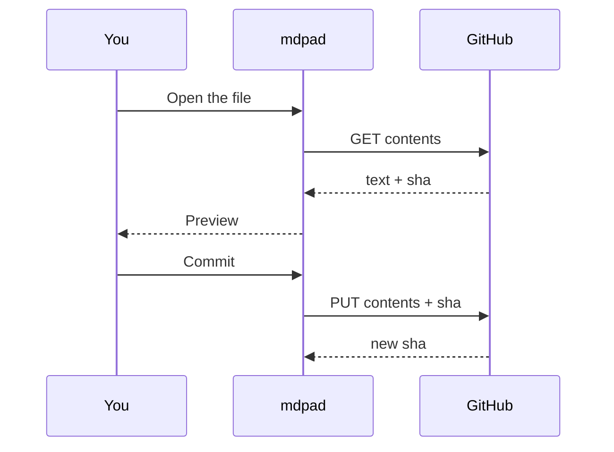
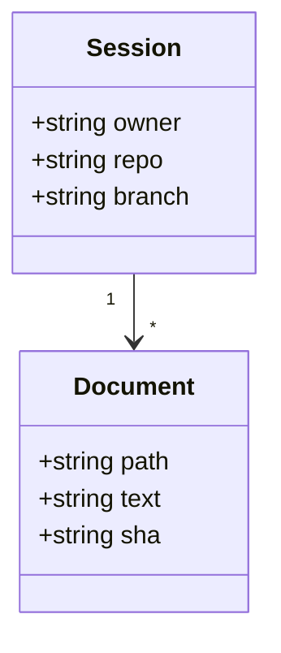
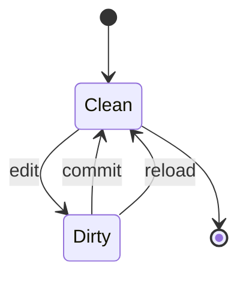
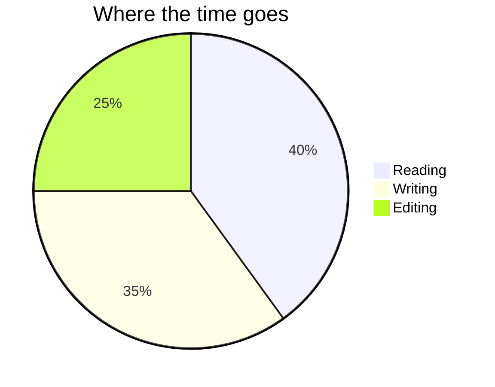
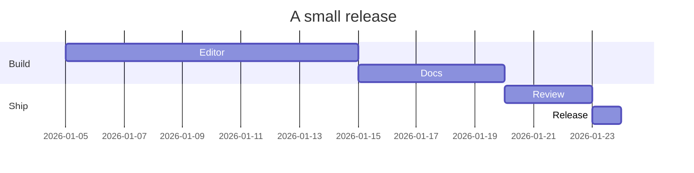

# Diagrams

Mermaid diagrams are fenced blocks with the `mermaid` language. The preview renders them; the file
keeps the source.

## Flowchart



## Sequence



## Class



## State



## Pie



## Gantt



## A broken diagram

A syntax error shows the source instead of an empty box:

```mermaid
flowchart TD
  A[ --> B[
```

## Notes

- The language tag must be exactly `mermaid`.
- Diagrams are rendered lazily: the page loads first, the diagram follows.
- Click a diagram to open it larger.
